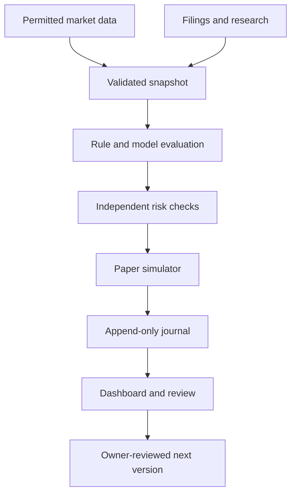

# Foolshot — executable experiment blueprint

**24 November 2026 | Paired paper learning workflow implemented | Companion to [the dossier](Foolshot_Project_Dossier.md)**

This plan defines the staged build. The [local replay foundation](README.md) implements Phase A with synthetic inputs. The [adaptive study](docs/research/study-protocol.md) also runs synthetic positions, reflections, paired controls and weekly research reports. Live operations remain under development. All times are IST. The first build is a replay and paper research harness, with a read-only shadow mode. Any real-money phase requires a separate owner and broker approval. Profit is uncertain; the 5% weekly target is a measurement, never a trading command.

## 1. Scope and architecture

Use Python 3.12, uv, Pydantic v2, httpx, asyncio, pytest, SQLite in WAL mode and Parquet via PyArrow. A single writer owns the journal. Store money as integer paise or decimal, never binary floating point. Store UTC timestamps plus exchange session date in Asia/Kolkata. Use Linux for a future always-on host, but develop and replay on the Mac first. Use FastAPI and a small local HTML dashboard; no Redis, vector database or agent framework is necessary at pilot scale. Pin dependency versions and record hashes of configuration, fixtures, prompts and model outputs.

The model sees bounded, timestamped evidence and outputs a proposal or pass. It cannot update the risk configuration, access secrets, write orders, or change its own deployment. The deterministic controller can veto proposals. In shadow mode, proposals are observations; no live order is sent. Live-account records, if later approved, are imported for comparison and reconciliation. A human uses the broker-approved interface for confirmed decisions until a separately reviewed compliant route exists.

## 2. Planned repository layout

| Path | Purpose |
|---|---|
| `pyproject.toml`, `uv.lock` | Dependencies, packaging, lint and test configuration. |
| `config/experiment.yaml` | Fixed study ID, dates, target, draft limits, mode and owner approvals. |
| `config/data_sources.yaml` | Source permissions, cadence, staleness rules and retention. |
| `config/calendar/` | Dated official session calendar with special sessions and provenance. |
| `config/fees/` | Effective-dated broker/segment cost schedules with source links. |
| `config/prompts/` | Versioned model instructions and response schema. |
| `src/foolshot/` | Modules below; no import-time network calls. |
| `tests/unit/`, `tests/integration/`, `tests/replay/`, `tests/fixtures/` | Deterministic tests, fault scenarios and sanitised sample records. |
| `data/raw/`, `data/normalized/`, `data/runs/` | Immutable permitted inputs, derived tables and per-run evidence bundles. |
| `reports/daily/`, `reports/weekly/`, `reports/final/` | Generated results, including failed and zero-trade sessions. |
| `ops/` | Service definitions, deployment checklist, recovery runbook; no secrets. |

## 3. Python module contracts

Each CLI returns zero on success, nonzero on failed checks. Scripts emit structured events to the journal, with run ID, timestamps and source/config versions. Implement in dependency order. The README identifies the current entry point and implemented contracts. This table describes the complete target system.

| Module under `src/foolshot/` | Input → output and responsibility | When called |
|---|---|---|
| `settings.py` | YAML + explicitly permitted environment settings → immutable validated configuration; reject unsupported mode, malformed limits or missing sources. | Every startup. |
| `schemas.py` | Raw records → typed `Quote`, `Bar`, `Filing`, `Decision`, `RiskResult`, `PaperFill`, `Incident` and `SessionManifest`. | All boundaries. |
| `clock.py` | UTC timestamp + calendar → session state, open/close and research window; reject missing calendar. | Startup and each tick. |
| `journal.py` | Typed event → transactional event row and immutable artifact reference; unique event IDs, payload digest and schema version. | Every state change. |
| `calendar_sync.py` | Official calendar export + reviewed metadata → versioned session calendar; compare old/new schedules. | Weekly and before session. |
| `instrument_master.py` | Permitted instrument file → symbol/security mapping, segment, tick, lot and status; preserve effective date. | Before open. |
| `market_data.py` | Licensed read-only snapshots or fixture playback → normalized timestamped quote events; track connection health. | Session or replay. |
| `bars.py` | Quotes/trades → complete minute bars; no incomplete candle use; handle duplicate/late data. | Streaming and replay. |
| `news.py` | Permitted exchange/company disclosures → deduplicated filings with publish and receipt times. | Before open and periodic permitted polling. |
| `research_context.py` | Filing metadata, daily bars, optional NSE/Screener research results → dated context; label stale and missing fields. | Pre-open and decision window. |
| `features.py` | Completed bars and snapshot → versioned indicators and benchmark features; reset session features daily. | Decision windows. |
| `snapshot.py` | Features, source references, paper account state, freshness flags → immutable evaluation packet. | Each evaluation. |
| `baseline.py` | Snapshot + frozen baseline definition → hypothetical baseline decision. | Matching evaluation timestamps. |
| `model_adapter.py` | Snapshot + versioned prompt → bounded typed proposal/pass; capture model ID, token usage, latency and raw output; no write tools. | Scheduled evaluation. |
| `validate_decision.py` | Model response + snapshot → valid proposal or rejection with reason. Reject missing evidence, stale output and untrusted directives. | Each model response. |
| `fees.py` | Effective-dated fee schedule + hypothetical or imported fills → itemised charges; contract note override for actual results. | Sizing, replay, reports. |
| `risk.py` | Proposal, paper ledger, quote quality and draft limits → allow/reject with reason codes. Never modifies live positions. | Before simulated entry. |
| `paper_engine.py` | Approved hypothetical proposal + later observed eligible quotes → simulated fills and simulated position lifecycle. Model cannot choose its fill price. | Replay or paper sessions. |
| `paper_ledger.py` | Simulated fills + charges → cash, open quantity, reserved risk and marked P&L. | Every simulated event. |
| `broker_readonly.py` | Approved read-only broker export/API → account snapshot for comparison; refuse order actions; prefer read-only credentials. | Optional shadow startup and close. |
| `reconcile.py` | Imported statements/snapshots + journal → mismatch report for fills, quantities, fees and cash; unidentified positions flagged for owner. | Startup, close, restart. |
| `health.py` | Feed, calendar, journal and model health events → status and alert envelope. | Every 30 seconds during research run. |
| `session.py` | Validated config and calendar → orchestration of scheduled read-only work, paper state and close report. | Daily. |
| `replay.py` | Manifest + immutable period data → deterministic event chronology and simulation results. | Offline on demand. |
| `audit.py` | Run manifest and journal → result on future leakage, missing traces, invalid fills and cost discrepancies. | Every replay/weekly. |
| `metrics.py` | Audited ledger and incidents → economic and operational scorecards. | Daily and weekly. |
| `report.py` | Scorecard plus source links → redacted HTML/Markdown handoff. | Session close and weekly review. |
| `dashboard.py` | Read-only journal queries → run selector, data health, decisions, simulated versus imported results and incident views. | Local service. |
| `review.py` | Evidence + candidate change → hypothesis/change record, acceptance results and owner sign-off status. | Weekly; never auto-deploy. |

## 4. Storage and traceability

| Table | Required fields beyond primary key |
|---|---|
| `sessions` | date, mode, start/end, status, config/prompt/model hashes, calendar version, data license reference |
| `source_events` | source, instrument, exchange/publish time, received time, quality, artifact hash |
| `snapshots` | session, cutoff timestamp, source event IDs, feature version, freshness |
| `decisions` | snapshot, model/rule, response hash, proposal/pass, evidence IDs, expiry, latency, token cost |
| `risk_checks` | decision, verdict, every reason, policy hash, requested and permitted hypothetical size |
| `paper_orders`, `paper_fills` | decision, simulated state, time, quantity, price, fill policy, cost estimate |
| `imported_broker_records` | source document hash, account alias, broker record ID, timestamp, quantity, price, actual charges |
| `ledger_entries` | session, bucket, amount, event reference, mode; distinct simulated and actual books |
| `incidents` | category, start/end, affected mode, observed state, response and review status |
| `reviews` | hypothesis, training/validation dates, holdout access count, trial count, approval, rollback version |

Raw model requests and responses are retained in a redacted artifact store. Do not store credentials, full personal identifiers or unrestricted copyrighted feeds in shared traces. A replay must reference the exact input digests. Corrections append events; do not rewrite the original rationale or outcome. Separate paper, replay, shadow and broker-confirmed observations in every query and export.

## 5. Proposed daily scheduler

Times are pilot defaults, not exchange rules. Calendar overrides holidays and special sessions. Missing or conflicting calendar data blocks evaluation. Confirm session hours from official sources before enablement.

| IST | Task | Output |
|---|---|---|
| 08:45 | Host and database check; calendar and config validation | Run manifest or blocked-session incident |
| 08:50 | Start process and heartbeat alerts | Process healthy status |
| 09:00 | Instrument metadata, research sources, prior session handoff | Research packet with timestamps |
| 09:15 | Start permitted observe-only quote collection | Feed quality and completed bars |
| 09:15–09:45 | Warmup; no new paper entries | Baseline features and validation |
| 09:45–14:30 | Evaluate at 15-minute checkpoints and deduplicated relevant filings | Snapshot, pass/proposal, risk verdict, paper lifecycle |
| 14:30 | Stop new hypothetical entries | Entry-disabled status |
| 15:00–15:15 | Close hypothetical intraday exposure under documented simulator assumptions | Closing fills or unresolved-state incident |
| 15:30 onward | Freeze session, import permitted records, reconcile | P&L, fees, incidents and missing records |
| 16:30 | Generate handoff and dashboard refresh | Daily report including non-trading days |
| Saturday 10:00 | Independent review; cost and holdout audit, candidate changes | Approved or rejected change record |

If a model call fails, times out, exceeds budget or returns invalid output, record a pass; do not retry indefinitely. If a quote stream goes stale, stop new hypothetical entries until quality recovers. A proposed 10-second heartbeat threshold must be calibrated against actual feed cadence; no synthetic price is substituted. Missing closing quotes are unresolved, not invented fills. A heartbeat alert is not an order signal.

## 6. Experiment controls and measurement

Study parameters carried from the dossier (all small limits are draft): initial capital ceiling ₹100,000; initial hypothetical exposure ₹10,000; possible later separately reviewed ceiling ₹25,000; ₹125 planned risk per trade; ₹350 session, ₹1,000 weekly and ₹5,000 all-in study stop; no leverage, overnight positions, options or automatic top-ups. Limit two attempted paper entries per session and one open paper position. Do not bypass a pass because a target was missed. Keep all losses and attempts in the denominator. The risk check includes fees, adverse execution sensitivity, pending exposure and available budget. Stops do not guarantee loss containment in real markets.

Use the same snapshot and feature pipeline for paper and replay. A simulated fill must follow the decision time and use observed eligible prices, not the decision candle close. If within-bar ordering is ambiguous, record ambiguity and show conservative sensitivity. Test wider spreads, extra slippage, delayed inputs, missing fills and top-profit-trade removal. The Bazaar code is reference material, not an endorsed tariff or calibrated model. Record every strategy variant tested and keep final holdouts untouched until review. Score the frozen baseline on matching times. No one-minute scalping or near-expiry option lottery enters the initial experiment.

Measure gross and net P&L, charges, spread/slippage attribution, all-in costs, peak drawdown, exposure time, attempted/pass/filled counts, expectancy, win rate and operational availability. Use actual contract notes for real transactions, never simulated fills. Account for designated idle funds, withdrawals and settlement once. Reserve profits above the applicable principal only after reconciling; withdrawals remain manual owner actions. Compare against ₹5,000/week on original capital, explicitly reporting misses. Model, data and hosting costs count in all-in reporting.

## 7. Build order and acceptance gates

| Phase | Work | Acceptance evidence |
|---|---|---|
| A · foundation | Config, schemas, journal, fixture dataset, clock and instruments | Deterministic event IDs; restart retains rows; holiday/special-session tests pass. |
| B · data | Read-only provider contract, ingestion, bars, research context and snapshots | Duplicate, out-of-order, missing and stale events handled; no future data in snapshots. |
| C · decisions | Baseline, model adapter and strict output validation | Recorded model version; every pass and invalid proposal logged; no model access to credentials or write tools. |
| D · paper engine | Fees, risk, simulation and ledger | Partial-fill, spread, no-fill, ambiguous stop, repeated-loss and budget tests pass. |
| E · evaluation | Replay, audit, metrics and dashboard | Repeat a run from hashes; same deterministic result with recorded model responses; results isolated by mode. |
| F · operations | Scheduler, heartbeat and alert drills, backup and restore | Process crash, outage, unexpected restart and calendar error produce visible blocked states. |
| G · shadow | Only approved data/account read access; compare imported records | No real order permissions in the model environment; position and cash mismatch alerts verified. |
| Separate decision · real trial | Owner and broker review eligible route, approvals, protections, funding and emergency arrangements | Written confirmation, reviewed test evidence and explicit owner sign-off. This blueprint does not authorize live execution. |

Target one preparatory week for an initial harness if dependencies and data are ready. Days 1–2 foundation/data, day 3 model and baseline, day 4 simulation, day 5 audit/dashboard, days 6–7 fault drills and review. Delays extend preparation; the 90-calendar-day live clock does not start until prerequisites are satisfied and the owner authorizes it. Report a blocked launch as a valid finding.

## 8. Fault-injection acceptance checklist

| Test fixture | Expected outcome |
|---|---|
| Stale holiday cache on normal day | Calendar mismatch logged; no silent shutdown mistaken for a no-trade decision. |
| Changed network/IP or expired session | Read-only availability error; alert owner; never bypass broker authorization. |
| Stale quote, missing tick, disconnected stream | Mark degraded; no new simulated entry; retain evidence. |
| Malformed or late model output | Reject and log pass; risk rules unchanged. |
| Duplicate event, timeout, late or partial fill | Paper ledger remains idempotent; actual imported mismatches unresolved until verified. |
| Manual holdings in broker snapshot | Do not attribute to the experiment without documented ownership. |
| Overlapping simulated exits or missing protection | Paper scenario flags quantity/protection error; require review. |
| Human asks to trade more or recover losses | Risk policy and no-trade rule remain fixed; log intervention. |
| Fee schedule changes | New dated version; previous runs reproduce under prior version. |
| Process dies between decision and journal commit | Replay from durable checkpoint; no fabricated outcomes. |
| Backup corruption or disk full | Block session, alert and restore verified checkpoint. |

## 9. Research reuse and unresolved launch decisions

- [Central register](offline-research/resources/INDEX.md) and [sweep register](offline-research/x-india-sweep/repos/INDEX.md): consult before any download. Use Bazaar for paper clock, fills, fees and risk checks; Screener MCP only for research design. Use AI Hedge Fund risk-event pattern, Freqtrade lookahead audit, Nautilus reconciliation test concepts, Claude Trading Skills sensitivity checks and OpenAlgo as a broker documentation comparison. Review licenses before copying code.
- Verify [NSE circular 58/2026](https://nsearchives.nseindia.com/content/circulars/INSP77559.pdf) and broker eligibility; the AI-assisted own-algorithm undertaking is unresolved. Do not claim eligibility based on hosting alone. [Dhan authentication](https://dhanhq.co/docs/v2/authentication/) documents static-IP requirements. [NSE MCP](https://www.nseindia.com/nse-mcp) is delayed research data, not an execution feed.
- Owner must approve the draft risk budget, cost budget, allowed data license, model provider, account route and policy for manual interventions. Check broker-specific charges, calendar, freeze sizes, data subscriptions and actual account capabilities. No vendor account, VPS or paid subscription has been purchased.
- Phase A now runs locally. Phase B adds completed bars, freshness checks and point-in-time snapshots before strategy or fill simulation begins. Do not claim the experiment is operational until its tests and evidence exist.

## Implementation review · 24 November 2026

- The dossier describes the eventual live trial. The first software milestone validates fixture data and records replay evidence. A replay date never advances the 90-day clock.
- For the regular pilot schedule, the first eligible checkpoint is 09:45 IST. The 14:30 cutoff excludes that checkpoint. The fixture clock reserves the final 60 minutes and uses a 30-minute warmup. A shortened session can therefore have zero eligible checkpoints. Confirm actual special-session windows before using a production calendar.
- Source events need both exchange and receipt times. Playback orders by receipt time, then exchange time and source ID to break ties. Phase B must also exclude events received after the snapshot cutoff and prevent older exchange quotes from replacing newer ones.
- Keep the weekly target on net trading P&L after trading charges. Report all-in P&L after external operating costs separately. Apply the proposed study stop to both loss from principal and drawdown from peak. Phase A validates the draft configuration. Enforcement belongs to Phase D.
- Timing depends on data rights, broker eligibility and fault-drill results. A one-week build estimate supplies no evidence that those conditions have been met.

## Dhan implementation update

Dhan is the selected broker. The shared CLI now supports DhanHQ account preflight, NSE equity depth capture, interactive Dhan MCP registration for Codex and Claude Code, and a synthetic gap-through-stop rehearsal. An optional Linux timer runs the preflight. The [README](README.md) lists commands and outstanding live controls. Raw MCP order tools would sit outside the risk controller. Keep the scheduled worker independent of interactive broker-write access.

## Paper review foundation · 24 November 2026

The latest owner clarification supersedes the proposed halt based on decline from the equity peak. Daily loss uses opening equity and includes marks and costs. Scripts/study runs the cross-session synthetic paper book, saves operator input, stores a pre-entry decision before outcomes, links postchecks, locks excess capital at close and builds incident, daily and weekly evidence packets. Headless review output is stored as an unapproved proposal. Live broker accounting and reconciliation remain separate work.

## Adaptive versus frozen experiment

The [protocol](docs/research/study-protocol.md) defines the publication objective and evidence requirements. The cohort runner executes matched synthetic sessions in isolated ledgers, records versioned decision packets, performs position, incident, daily and weekly model reviews, and reports later paired performance. Both Codex and Claude Code use the same contracts. A weekly suggestion can become a future decision input; changes to executable code require separately tested versions. The initial implementation supports fixed synthetic depth and estimated costs. Licensed Dhan ingestion, actual fill reconciliation, operating-cost measurement and a preregistered production roster precede live efficacy claims.

## Two-tier model dispatch

Route strategic tasks and trade/pass choices to the thinking tier. Routine daily and position summaries use a separate operational schema without strategy fields. Every routed request records the intended tier, and each response captures the available model and usage receipt. History queries expose actor identity and the originating decision separately. Both paired arms share their thinking release. Keep provider upgrades across cohorts visible in the publication record.
